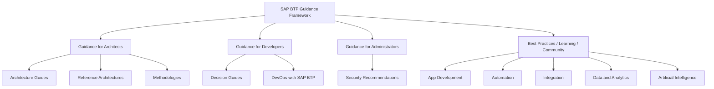

<!-- loio27720e060ccb4ed088c043c183beb92d -->

# SAP BTP Guidance Framework

SAP BTP Guidance Framework is your compass for architecting, implementing, and operating solutions on SAP BTP. It provides a central access point for decision guides, reference architectures, methodologies, and best practices across all SAP BTP capability areas — for architects, developers, and administrators.

<a name="loio27720e060ccb4ed088c043c183beb92d__section_architecture"/>

## Architecture Overview

The following diagram shows the structural relationship between the SAP BTP Guidance Framework, its three target audiences, and the five SAP BTP capability areas it covers.

**SAP BTP Guidance Framework — Key Components**

<table>
<tr>
<th valign="top">

Component

</th>
<th valign="top">

Type

</th>
<th valign="top">

Target Audience

</th>
</tr>
<tr>
<td valign="top">

Integration Architecture Guide

</td>
<td valign="top">

Architecture Guide

</td>
<td valign="top">

Architects

</td>
</tr>
<tr>
<td valign="top">

Extension Architecture Guide

</td>
<td valign="top">

Architecture Guide

</td>
<td valign="top">

Architects

</td>
</tr>
<tr>
<td valign="top">

SAP BTP Reference Architectures

</td>
<td valign="top">

Reference Architecture

</td>
<td valign="top">

Architects

</td>
</tr>
<tr>
<td valign="top">

SAP Integration Solution Advisory Methodology

</td>
<td valign="top">

Methodology

</td>
<td valign="top">

Architects

</td>
</tr>
<tr>
<td valign="top">

SAP Application Extension Methodology

</td>
<td valign="top">

Methodology

</td>
<td valign="top">

Architects

</td>
</tr>
<tr>
<td valign="top">

SAP Data and Analytics Advisory Methodology

</td>
<td valign="top">

Methodology

</td>
<td valign="top">

Architects

</td>
</tr>
<tr>
<td valign="top">

SAP BTP Developer's Guide

</td>
<td valign="top">

Decision Guide

</td>
<td valign="top">

Developers

</td>
</tr>
<tr>
<td valign="top">

DevOps with SAP BTP

</td>
<td valign="top">

DevOps

</td>
<td valign="top">

Developers

</td>
</tr>
<tr>
<td valign="top">

Security Recommendations

</td>
<td valign="top">

Recommendations

</td>
<td valign="top">

Administrators

</td>
</tr>
</table>

<a name="loio27720e060ccb4ed088c043c183beb92d__section_overview"/>

## Framework Overview

The SAP BTP Guidance Framework addresses three primary audiences across the full SAP BTP capability landscape.

-   **Guidance for architects** — architecture guides, reference architectures, and methodologies
-   **Guidance for developers** — decision guides and DevOps practices
-   **Guidance for administrators** — security recommendations

The framework covers five SAP BTP capability areas:

-   App Development
-   Automation
-   Integration
-   Data and Analytics
-   Artificial Intelligence \(AI\)

A foundation layer of best practices, learning and enablement content, and community resources supports all three audiences.

<a name="loio27720e060ccb4ed088c043c183beb92d__section_components"/>

## Framework Components

**Framework Components by Guidance Area**

<table>
<tr>
<th valign="top">

Guidance Area

</th>
<th valign="top">

Category

</th>
<th valign="top">

Components

</th>
</tr>
<tr>
<td valign="top">

Guidance for Architects

</td>
<td valign="top">

Decision Guides

</td>
<td valign="top">

Integration Architecture Guide; Extension Architecture Guide

</td>
</tr>
<tr>
<td valign="top">

Guidance for Architects

</td>
<td valign="top">

Reference Architectures

</td>
<td valign="top">

SAP BTP Reference Architectures; SAP BTP Solution Diagram Design Repository; Business Process Blueprints

</td>
</tr>
<tr>
<td valign="top">

Guidance for Architects

</td>
<td valign="top">

Methodologies

</td>
<td valign="top">

SAP Integration Solution Advisory Methodology; SAP Application Extension Methodology; SAP Data and Analytics Advisory Methodology

</td>
</tr>
<tr>
<td valign="top">

Guidance for Developers

</td>
<td valign="top">

Decision Guides

</td>
<td valign="top">

SAP BTP Developer's Guide

</td>
</tr>
<tr>
<td valign="top">

Guidance for Developers

</td>
<td valign="top">

DevOps

</td>
<td valign="top">

DevOps with SAP BTP

</td>
</tr>
<tr>
<td valign="top">

Guidance for Administrators

</td>
<td valign="top">

Recommendations

</td>
<td valign="top">

Security Recommendations

</td>
</tr>
</table>

<a name="loio27720e060ccb4ed088c043c183beb92d__section_methodologies"/>

## Methodologies

Methodologies provide a structured and technology-agnostic approach to define and execute domain-specific strategies. The SAP BTP Guidance Framework includes three methodologies.

-   **SAP Integration Solution Advisory Methodology** — guides the definition and execution of integration strategies across SAP and non-SAP systems
-   **SAP Data and Analytics Advisory Methodology** — provides a structured approach for data and analytics strategy and platform selection
-   **SAP Application Extension Methodology** — guides teams through assessing extension use cases, selecting extension technologies, and defining target solutions

<a name="loio27720e060ccb4ed088c043c183beb92d__section_reference_architectures"/>

## SAP BTP Reference Architectures

SAP BTP reference architectures are curated solution templates for designing solution architectures on SAP BTP, available at SAP Discovery Center.

Each SAP BTP reference architecture consists of:

-   An architecture diagram
-   Guiding information
-   Related services and missions

> ### Note:  
> The SAP BTP Solution Diagram Design Guideline is a new addition to the reference architectures section. It provides standardized notation and design patterns for creating SAP BTP solution diagrams.

<a name="loio27720e060ccb4ed088c043c183beb92d__section_extension_guide"/>

## Extension Architecture Guide

The Extension Architecture Guide is a three-phase decision guide that helps teams assess extension use cases, select the right extension technology, and define a target solution. It is available in SAP Discovery Center as part of the SAP BTP Guidance Framework and helps identify the right technical extension building block for your presentation tier.

### Phase 1: Assess Extension Use Case

Phase 1 establishes the context for the extension:

-   **System context** — the technical landscape in which the extension operates
-   **Business and context requirements** — the business drivers and constraints shaping the extension
-   **Application extension use case** — the specific capability to be extended

### Phase 2: Assess Extension Technology

Phase 2 identifies the appropriate extension approach:

-   **Extension styles** — the architectural pattern, such as in-app or side-by-side extension
-   **Extension task** — the specific technical task to be performed
-   **Extension technology mapping** — the mapping of tasks to technical extension building blocks

### Phase 3: Define Extension Target Solution

Phase 3 produces the actionable solution definition:

-   **Extension technology per extension task** — the selected technical building block for each task
-   **Decision guidance assets** — the supporting decision tools and guidance materials
-   **Extension target solution** — the final solution design

<a name="loio27720e060ccb4ed088c043c183beb92d__section_technology_mapping"/>

## Extension Technology Mapping

The extension technology mapping defines the relationship between extension tasks and the technical building blocks used to implement them.

-   The extension technology mapping outlines the relationship between extension tasks and technical extension building blocks.
-   Extension tasks can be implemented by using one or more technical extension building blocks.
-   A technical extension building block can be categorized into extension domains, such as the core solution extension domain and the side-by-side extension domain.

**Extension Technology Mapping — Example \(P02: New User Interface\)**

<table>
<tr>
<th valign="top">

ID

</th>
<th valign="top">

Extension Style

</th>
<th valign="top">

Extension Task

</th>
<th valign="top">

Technical Extension Building Block

</th>
<th valign="top">

Guidance

</th>
<th valign="top">

Color Code

</th>
</tr>
<tr>
<td valign="top">

P02

</td>
<td valign="top">

New User Interface

</td>
<td valign="top">

Create custom UI

</td>
<td valign="top">

Classic Extensibility: Dynpro

</td>
<td valign="top">

\<to be filled out by project team\>

</td>
<td valign="top">

\<to be filled out by project team\>

</td>
</tr>
<tr>
<td valign="top">

P02

</td>
<td valign="top">

New User Interface

</td>
<td valign="top">

Create custom UI

</td>
<td valign="top">

Classic Extensibility: WebDynpro ABAP

</td>
<td valign="top">

\<to be filled out by project team\>

</td>
<td valign="top">

\<to be filled out by project team\>

</td>
</tr>
<tr>
<td valign="top">

P02

</td>
<td valign="top">

New User Interface

</td>
<td valign="top">

Create custom UI

</td>
<td valign="top">

SAPUI5

</td>
<td valign="top">

\<to be filled out by project team\>

</td>
<td valign="top">

\<to be filled out by project team\>

</td>
</tr>
<tr>
<td valign="top">

P02

</td>
<td valign="top">

New User Interface

</td>
<td valign="top">

Create custom UI

</td>
<td valign="top">

SAP Fiori Elements

</td>
<td valign="top">

\<to be filled out by project team\>

</td>
<td valign="top">

\<to be filled out by project team\>

</td>
</tr>
<tr>
<td valign="top">

P02

</td>
<td valign="top">

New User Interface

</td>
<td valign="top">

Create custom UI

</td>
<td valign="top">

SAP Mobile Services

</td>
<td valign="top">

\<to be filled out by project team\>

</td>
<td valign="top">

\<to be filled out by project team\>

</td>
</tr>
<tr>
<td valign="top">

P02

</td>
<td valign="top">

New User Interface

</td>
<td valign="top">

Create custom UI

</td>
<td valign="top">

SAP Build Apps

</td>
<td valign="top">

\<to be filled out by project team\>

</td>
<td valign="top">

\<to be filled out by project team\>

</td>
</tr>
</table>

**Color Code Legend**

<table>
<tr>
<th valign="top">

Color Code

</th>
<th valign="top">

Description

</th>
</tr>
<tr>
<td valign="top">

\<to be filled out by project team\>

</td>
<td valign="top">

\<to be filled out by project team\>

</td>
</tr>
<tr>
<td valign="top">

\<to be filled out by project team\>

</td>
<td valign="top">

\<to be filled out by project team\>

</td>
</tr>
<tr>
<td valign="top">

\<to be filled out by project team\>

</td>
<td valign="top">

\<to be filled out by project team\>

</td>
</tr>
</table>

<a name="loio27720e060ccb4ed088c043c183beb92d__section_summary"/>

## Summary

SAP BTP Guidance Framework provides architects, developers, and administrators with a central access point for creating and operating enterprise-grade solutions on SAP BTP.

Current scope:

-   Decision guides
-   Reference architectures
-   Methodologies
-   DevOps principles
-   Best practices, learning and enablement, and community resources

**Related Information**  

[Agent Development Concept — CIS Industry AI](../Agent-Development-Concept/agent-development-concept-870f31e.md)

[Introduction](../Introduction/introduction-81672c4.md)
